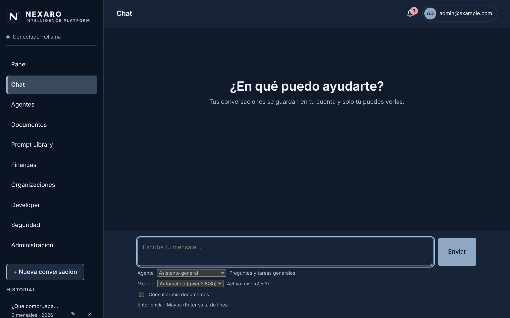
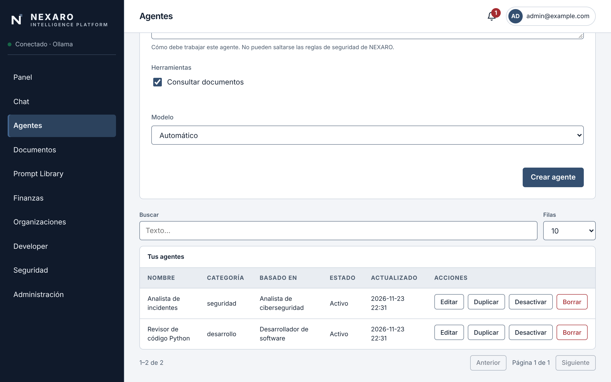
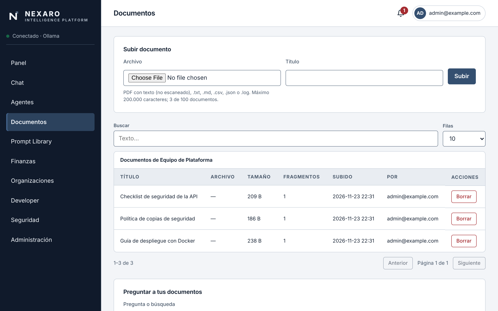
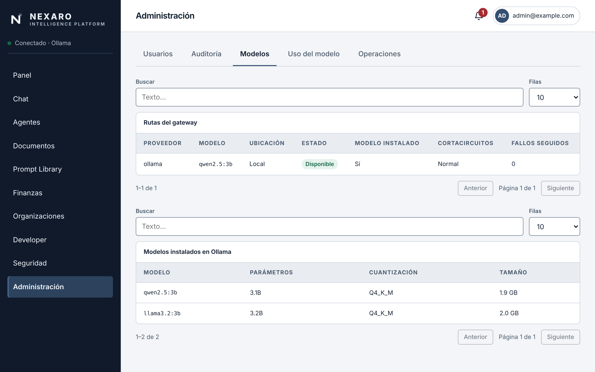
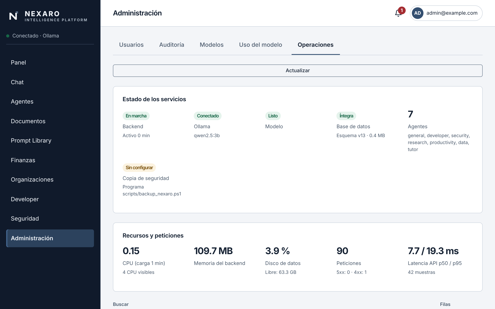
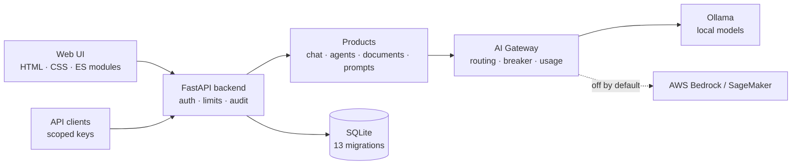

<div align="center">

<picture>
  <source media="(prefers-color-scheme: dark)" srcset="docs/assets/brand/nexaro-logo-dark.svg">
  
</picture>

### Private AI. Intelligent Agents. Your Infrastructure.

A self-hosted AI workspace that brings local models, specialised agents, your documents
and security controls into one environment that runs on your own machine.

[](https://github.com/Marbi8891/NEXARO-PERSONAL-AI-/actions/workflows/ci.yml)


-0B1220)


[Install](docs/getting-started/installation.md) ·
[Quick start](docs/getting-started/quick-start.md) ·
[Capabilities](docs/product/capabilities.md) ·
[Architecture](docs/architecture/overview.md) ·
[Roadmap](ROADMAP.md) ·
[Docs](docs/README.md)

</div>

<p align="center">
  
</p>

## What is NEXARO?

NEXARO is a **self-hosted AI workspace** for individuals and small teams who want the productivity
of AI assistants **without sending their conversations and documents to a third party**. It runs
models locally through [Ollama](https://ollama.com), adds the things a raw model server lacks
(accounts, specialised agents, document retrieval with sources, a prompt library, organizations,
an API, audit and operations), and ships as one hardened Docker Compose stack.

| | |
|---|---|
| **Who it is for** | Developers, students, privacy-conscious professionals and small teams running AI on their own hardware |
| **Problem it solves** | Hosted assistants require trusting a provider with your data; a bare local model has no accounts, agents, knowledge or controls |
| **What it does today** | Local chat with streaming, 7 built-in agents plus your own, questions over your documents with cited sources, a versioned prompt library, multi-tenant organizations, scoped API keys, audit, security summary and operations panel |
| **Why use it** | Data stays on your machine by default; deny-by-default security; every decision documented; 800+ automated tests |
| **How to try it** | Docker + three commands: see [Quick start](#quick-start) |

## Project status

**v1.0: stable for self-hosting on a single machine.** Deployed and verified end to end with a real
Ollama model (install, real answer, restart and persistence) on macOS and Windows. Agents are
currently *prompt profiles with permissioned tools*; an autonomous agent runtime, orchestration and
memory are **planned, not implemented**. The [capability matrix](docs/product/capabilities.md) lists the
exact status of every feature, with the tests that back it.

## Core capabilities

| | |
|---|---|
| **Local AI chat** | Streaming answers from Ollama models, cancel, Markdown, history, rename/delete, per-conversation model pinning |
| **Specialised agents** | General, Developer, Cybersecurity, Research, Productivity, Data, Programming Tutor. Create your own with instructions and a subset of tools; safety rules are enforced in code |
| **Knowledge** | Upload text and PDF documents per organization; BM25 retrieval with **cited sources** in chat; read-only Obsidian vault |
| **Prompt library** | Versioned prompts with variables, history and restore; catalogue of 100 prompts |
| **AI Gateway** | Provider routing and fallback, per-provider circuit breaker, input/output limits, usage and cost ledger |
| **Organizations and API** | Roles and permissions, tenant isolation at the database level, scoped API keys with per-key rate limits (`/api/v1`) |
| **Security and operations** | Manual account approval, append-only audit log, security summary, operations panel (services, resources, DB integrity, backups) |

<table>
  <tr>
    <td width="50%"><br><sub><b>Agents</b>: personal agents with permissioned tools</sub></td>
    <td width="50%"><br><sub><b>Documents</b>: knowledge base for retrieval with sources</sub></td>
  </tr>
  <tr>
    <td><br><sub><b>Models</b>: gateway routes, breaker status, installed models</sub></td>
    <td><br><sub><b>Operations</b>: services, integrity, resources, latency</sub></td>
  </tr>
</table>

<sub>Screenshots of the real application with demo data; the interface is currently in Spanish. How they are made: [docs/assets](docs/assets/README.md).</sub>

## Architecture

A **modular monolith** (FastAPI + plain ES-module frontend, no build step) with one-way dependencies
enforced by a test. Inference goes through a single AI Gateway; data lives in SQLite with versioned
migrations.



More: [Architecture overview](docs/architecture/overview.md) · [AI Gateway](docs/architecture/ai-gateway.md) ·
[Agents](docs/architecture/agents.md) · [25 ADRs](docs/decisions/README.md)

## Supported models and providers

| Provider | Status | Notes |
|---|---|---|
| **Ollama** (local) | Supported, default | Any model installed in Ollama; default `qwen2.5:3b` (CPU-friendly, ~2 GB) |
| AWS Bedrock, SageMaker | Experimental, **disabled by default** | Tested with test doubles only; require `AI_ALLOW_CLOUD=true` and a monthly budget |
| OpenAI, Gemini, others | Not implemented | — |

Measured, not claimed: with `qwen2.5:3b` on CPU, the reproducible evaluation suite passes **34/42
cases (81 %)**, median latency 30.7 s ([AI evaluation](docs/development/ai-evaluation.md)). Larger models
answer better and need more RAM.

## Privacy and security principles

- **Local by default**: the backend binds to `127.0.0.1`; Ollama publishes no port; no telemetry; no CDNs.
- **Deny by default**: no default accounts, no public registration, manual approval, Swagger off in Docker.
- **Enforced in code**: authorization, tenant isolation (composite foreign keys), agent tool permissions, rate and size limits, each with tests.
- **Hardened runtime**: non-root, read-only container, all capabilities dropped, image pinned by digest.
- **Verified supply chain**: pip-audit, Bandit, gitleaks, Trivy and an SBOM in CI.

Details: [Security](docs/security/README.md) · [Privacy](docs/security/privacy.md) · [Report a vulnerability](SECURITY.md)

## Quick start

Requirements: Docker with Compose ≥ 2.20, `make`, ~4 GB free RAM.

```bash
git clone https://github.com/Marbi8891/NEXARO-PERSONAL-AI-.git nexaro && cd nexaro
printf 'COMPOSE_PROFILES=ollama\nOLLAMA_NETWORK=nexaro_ollama\n' >> .env   # bundled Ollama
make up && make model && make smoke                                        # build, pull model, verify
docker exec -it nexaro-backend python -m nexaro_api.bootstrap_admin \
    --confirm-database /data/nexaro.db --email you@example.com              # first administrator
```

Open **<http://127.0.0.1:8001>**. Windows (PowerShell) commands, the external-Ollama mode and
troubleshooting are in the [installation guide](docs/getting-started/installation.md).

## Configuration

Configuration is by environment variables, validated at startup (unsafe settings stop the app).
The essentials: `OLLAMA_MODEL` (default model), `NEXARO_PORT` and `ALLOWED_ORIGINS` (local port and
origins), `CHAT_REQUESTS_PER_MINUTE` (limits), `AI_PROVIDER_ORDER` and `AI_ALLOW_CLOUD` (providers).
Full reference: [Configuration](docs/getting-started/configuration.md) and [`.env.example`](.env.example).

## Development

```bash
python3.12 -m venv .venv && . .venv/bin/activate
make install   # dependencies
make check     # ruff + mypy (strict) + pytest with coverage ≥ 80 %
make run       # API + UI with reload on 127.0.0.1:8001
make help      # every available command
```

[Development setup](docs/development/setup.md) · [Testing](docs/development/testing.md) ·
[Release process](docs/development/release-process.md)

## Documentation

| Start here | Understand it | Run it | Build on it |
|---|---|---|---|
| [Installation](docs/getting-started/installation.md) | [Capabilities](docs/product/capabilities.md) | [Docker deployment](docs/deployment/docker.md) | [Development setup](docs/development/setup.md) |
| [Quick start](docs/getting-started/quick-start.md) | [Architecture](docs/architecture/overview.md) | [Backup and restore](docs/deployment/backup-restore.md) | [API reference](docs/architecture/api-reference.md) |
| [Configuration](docs/getting-started/configuration.md) | [Security](docs/security/README.md) | [Troubleshooting](docs/getting-started/troubleshooting.md) | [Decisions (ADRs)](docs/decisions/README.md) |

Full index: [docs/README.md](docs/README.md). Detailed operational references are in Spanish, the project's working language.

## Roadmap

v1.0 stabilization → security audit findings → **Model Manager** → **Intelligent Model Router** →
**Agent Runtime** → **Persistent Task Engine** → **Orchestrator** → controlled multi-agent execution →
memory → advanced RAG → prompt library integration → secure coding agent. See [ROADMAP.md](ROADMAP.md).

## Contributing

Issues and pull requests are welcome. Read [CONTRIBUTING.md](CONTRIBUTING.md) first: small, verifiable
changes, `make check` green, and an ADR for significant decisions. Report security issues privately
([SECURITY.md](SECURITY.md)).

## License

Copyright © 2026 Mrabeh Fathi Boussayff. **Proprietary: all rights reserved.** The source is publicly
visible, but no licence to use, copy, modify or distribute it is granted without written permission
from the copyright holder. See [LICENSE](LICENSE).
