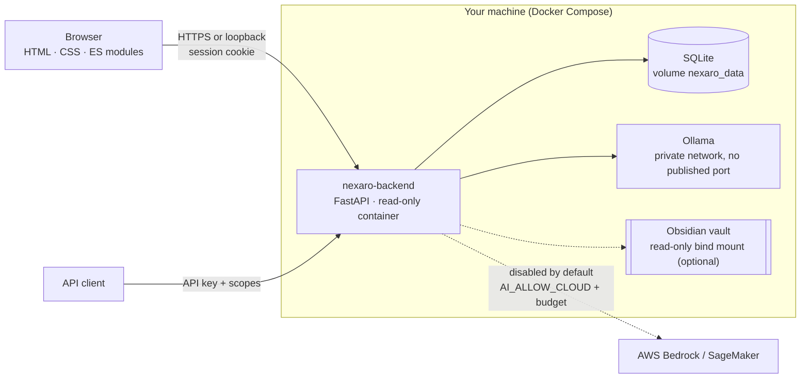
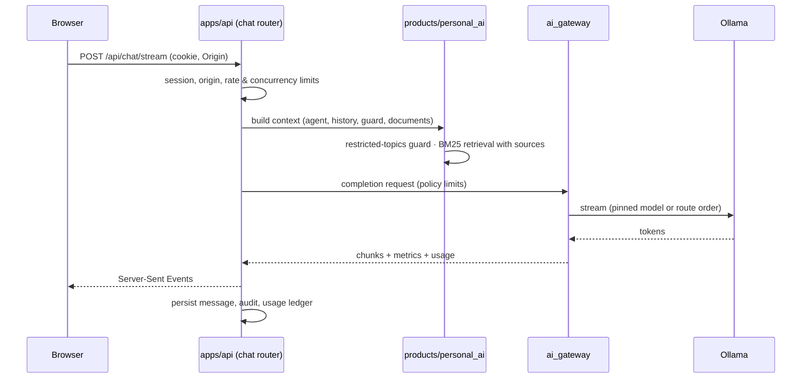

# Architecture overview

NEXARO is a **modular monolith** ([ADR-0001](../decisions/0001-modular-monolith.md)): one Python
process, one deployment, with modules whose dependencies point in one direction and are enforced by a
test. No microservices, no frontend build step.

← [Documentation home](../README.md) · Deep dives: [Module reference](modules.md) (ES) ·
[AI Gateway](ai-gateway.md) · [Agents](agents.md) · [API reference](api-reference.md) (ES) ·
[Target architecture](target-architecture.md)

## System context



- The backend publishes only `127.0.0.1:8001`. Ollama is reachable only on the private Docker network.
- The web UI is served by the backend itself; there is no separate frontend server.
- Cloud inference exists in code but is **off** unless explicitly enabled with a monthly budget.

## Layers and dependency rules

```
apps/api  ──►  products/*  ──►  packages/{nexaro_core, ai_gateway}
```

| Layer | Path | Responsibility |
|---|---|---|
| HTTP | `apps/api/nexaro_api/` | FastAPI app factory, routers, origin validation, cookies, security headers, request context |
| Products | `products/personal_ai/`, `products/finance/` | Use cases: chat, agents, documents (BM25), prompt library, guard, expenses |
| Core | `packages/nexaro_core/` | Config, security (scrypt, tokens, rate limiting), database and migrations, identity, audit, organizations, API keys, observability, Obsidian |
| AI Gateway | `packages/ai_gateway/` | Provider abstraction, routing and fallback, policy limits, circuit breaker, usage ledger |
| Frontend | `frontend/` | Single page, hash router, one view per screen, design tokens in `css/tokens.css` |

Rules, checked by `tests/unit/test_architecture.py`:

1. `packages/*` never import `products/*` or `apps/*`.
2. `products/*` do not import each other or `apps/*`.
3. `nexaro_core` and `products` do not import FastAPI/Starlette.

## Request flow: a chat message



## Data

- **SQLite** in WAL mode ([ADR-0015](../decisions/0015-sqlite-wal.md)); single writer, enough for one instance.
- **13 versioned migrations** with checksums, applied at startup in one transaction. Before migrating a
  database with data, a verified copy is written next to it. Startup aborts on failure (fail-fast).
- **Multi-tenancy:** `organization_id NOT NULL` plus composite foreign keys make cross-organization
  references impossible at the database level. A test fails if a new table breaks the rule.
- **PostgreSQL:** a parallel DDL set (with Row Level Security) is validated in CI against a real
  server, but the application does not run on PostgreSQL yet ([ADR-0005](../decisions/0005-migrations-multitenancy-postgres.md)).

## Frontend

Plain HTML, CSS and ES modules ([ADR-0007](../decisions/0007-frontend-es-modules.md)): no React, no
bundler. The DOM is built with a small `h()` helper (never `innerHTML`, enforced by a test). The CSP is
strict (`script-src 'self'`, no inline scripts or styles) and fonts are self-hosted. A screen is added
to the navigation only when it has a real API behind it.

## Deployment

One hardened container (read-only filesystem, non-root uid 10001, `cap_drop: ALL`,
`no-new-privileges`, memory/CPU/PID limits) plus Ollama. See [Docker deployment](../deployment/docker.md).
AWS Terraform exists but has never been applied ([ADR-0006](../decisions/0006-aws-infrastructure.md)).

## Where to go next

- Every architectural decision has an ADR: [decisions/](../decisions/README.md).
- What is planned but not built (agent runtime, orchestrator, memory, vector RAG):
  [target architecture](target-architecture.md) and [ROADMAP.md](../../ROADMAP.md).
