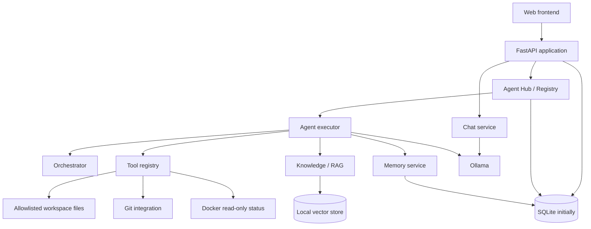

# NEXARO AI — System architecture

## Product goal

Ollama provides model inference; NEXARO owns application orchestration, persistence, permissions, tools, workspaces, and user interaction.

## Target architecture

## Principles

1. Start as a modular monolith; do not introduce microservices without measured need.
2. Use one shared Ollama service, not one model process per agent.
3. Load agent definitions on demand and execute sequentially by default on modest hardware.
4. Enforce permissions in backend code, never only through prompts.
5. Keep workspace data isolated and network access disabled by default.
6. Audit tool requests, approvals, results, and failures.

## Proposed backend boundaries

- api: HTTP routes and schemas.
- core: settings, lifecycle, logging and dependencies.
- chat: conversation lifecycle and Ollama streaming.
- models: Ollama model discovery and selection.
- agents: definitions, registry, validation, execution and orchestration.
- tools: contracts, registry, permission checks and implementations.
- memory: explicit memories and retrieval.
- knowledge: document ingestion, parsing, chunking, embeddings and retrieval.
- workspaces: project scoping and filesystem allowlists.
- tasks: user-approved tasks and automation definitions.

These are target boundaries, not claims that the modules already exist.

## Agent execution lifecycle

1. Resolve the selected agent by ID.
2. Verify it is enabled and allowed in the current workspace.
3. Resolve its requested model and verify availability.
4. Retrieve approved conversation and memory context.
5. Validate every requested tool against server-side allowlists and agent grants.
6. Require user approval for side effects.
7. Execute within iteration, tool-call, token and time budgets.
8. Record run and tool audit events.
9. Return the response and execution summary.

## Local deployment

Target device: ThinkPad T490 with 32 GB RAM. Use one Ollama instance and sequential agent execution by default. Do not assume all models can remain loaded concurrently.

## Target data model

workspaces, chats, messages, agents, agent_versions, agent_runs, tool_definitions, agent_tool_grants, tool_executions, memories, documents, document_chunks, tasks, automations, approval_requests.

Use migrations. SQLite is suitable for initial single-user deployment; repository interfaces should keep business logic independent of database choice.
